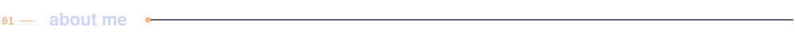
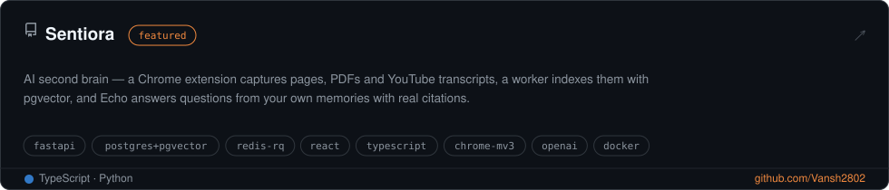
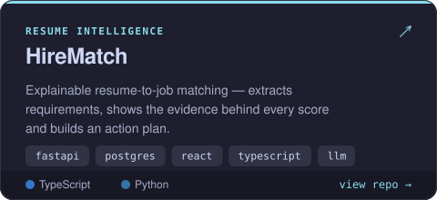
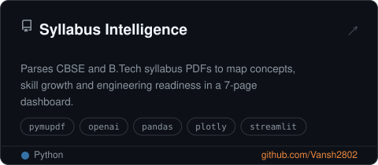

  
  
  
  

 

Final-year **B.Tech IT** student (graduating 2027) who builds products end to end — mostly backend, with enough frontend to ship.
I take team projects from idea to a working product, and I'm most at home with **Python, FastAPI, PostgreSQL** and **LLM-powered features**.

- 🛠️ **Building** — [Sentiora](https://github.com/Vansh2802/Sentiora-Vansh), an AI second brain, and [HireMatch](https://github.com/Vansh2802/HireMatch), explainable resume matching
- 📚 **Learning** — RAG, agents, backend system design and DSA on [LeetCode](https://leetcode.com/u/Vansh2802/)
- 💼 **Available from December 2026** for SDE · Backend · Full-Stack · AI Engineer roles — Pune preferred, open to relocating

 

   
   
  

  
  
  
  
  
  
  
  

 

  

  
  

  
  

 

  
  

  

  <picture>
    <source media="(prefers-color-scheme: dark)" srcset="https://raw.githubusercontent.com/Vansh2802/Vansh2802/output/github-contribution-grid-snake-dark.svg"/>
    <source media="(prefers-color-scheme: light)" srcset="https://raw.githubusercontent.com/Vansh2802/Vansh2802/output/github-contribution-grid-snake.svg"/>
    
  </picture>

<code>❯ code · learn · build · repeat</code>

