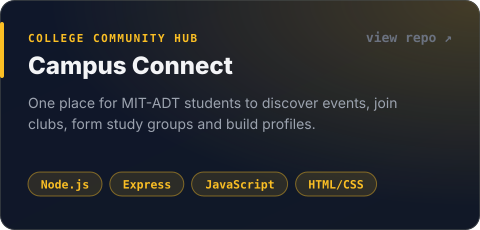

  
  
  
  

 

## About me

I'm a final-year **B.Tech IT** student who likes building things end to end — from the database schema to the last pixel of the UI.

- **Now building** — [Sentiora](https://github.com/Vansh2802/Sentiora-Vansh), an AI second brain that remembers what you read, and [HealHive](https://github.com/Vansh2802/HealHive), a mental-wellness platform with AI chat and real-time therapist sessions
- **Exploring** — Generative AI, RAG, LangChain, FastAPI and backend system design
- **Practising** — Data Structures & Algorithms on [LeetCode](https://leetcode.com/u/Vansh2802/)
- **Looking for** — Software Engineering roles (SDE · Backend · Full-Stack · AI Engineer)
- **Happy to collaborate** on full-stack and AI projects — say hi at [vanshasnani2802@gmail.com](mailto:vanshasnani2802@gmail.com)

 

## Tech stack

| | |
|---:|:---|
| **Languages** |  |
| **Frontend** |  |
| **Backend** |  |
| **Databases** |  |
| **Tools** |  |
| **AI / LLM** |        |

 

## Featured projects

  

  
  

  
  

 

## GitHub stats

  
  

  

  

  <picture>
    <source media="(prefers-color-scheme: dark)" srcset="https://raw.githubusercontent.com/Vansh2802/Vansh2802/output/github-contribution-grid-snake-dark.svg"/>
    <source media="(prefers-color-scheme: light)" srcset="https://raw.githubusercontent.com/Vansh2802/Vansh2802/output/github-contribution-grid-snake.svg"/>
    
  </picture>

 

## LeetCode

  

 

  <code>code → learn → build → repeat</code>
   
  

