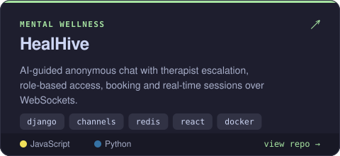

  
  
  
  

 

## About me

Final-year **B.Tech IT** student (graduating 2027) who builds products end to end — mostly backend, with enough frontend to ship.
I take team projects from idea to a working product, and I'm most at home with **Python, FastAPI, PostgreSQL** and **LLM-powered features**.

- **Building** — [Sentiora](https://github.com/Vansh2802/Sentiora-Vansh), an AI second brain, and [HireMatch](https://github.com/Vansh2802/HireMatch), explainable resume matching
- **Learning** — RAG, backend system design and DSA on [LeetCode](https://leetcode.com/u/Vansh2802/)
- **Available from December 2026** for SDE · Backend · Full-Stack · AI Engineer roles — Pune preferred, open to relocating

 

## Tech stack

| | |
|---:|:---|
| **Languages** |  |
| **Frontend** |  |
| **Backend** |  |
| **Databases** |  |
| **Tools** |  |
| **AI / LLM** |        |

 

## Featured projects

  

  
  

  
  

 

## GitHub stats

  
  

  <picture>
    <source media="(prefers-color-scheme: dark)" srcset="https://raw.githubusercontent.com/Vansh2802/Vansh2802/output/github-contribution-grid-snake-dark.svg"/>
    <source media="(prefers-color-scheme: light)" srcset="https://raw.githubusercontent.com/Vansh2802/Vansh2802/output/github-contribution-grid-snake.svg"/>
    
  </picture>

 

## LeetCode

  

 

  <code>code → learn → build → repeat</code>
   
  

