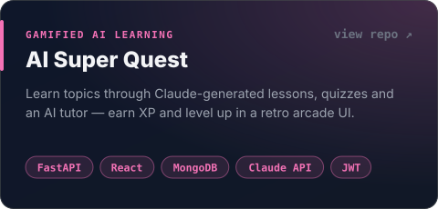

<a href="https://github.com/Vansh2802">
  
</a>

<p align="center">
  <a href="https://www.linkedin.com/in/vansh-asnani/"></a>
  <a href="mailto:vanshasnani2802@gmail.com"></a>
  <a href="https://leetcode.com/u/Vansh2802/"></a>
  
</p>

<br/>

## `>_ about.py`

```python
class Vansh:
    role      = "Full-Stack Developer · AI Engineer · Backend"
    education = "B.Tech Information Technology @ MIT-ADT University, Pune"
    building  = ["HealHive — AI mental-wellness platform", "LLM-powered apps"]
    exploring = ["Generative AI", "RAG", "LangChain", "FastAPI", "System Design"]
    grinding  = "DSA on LeetCode, one problem at a time"
    open_to   = ["SDE", "Backend Engineer", "Full-Stack", "AI Engineer"]

    def say_hi(self):
        return "Let's build something useful together 🚀"
```

<br/>

## `>_ tech-stack`

<table>
  <tr>
    <td align="right"><sub><b>LANGUAGES</b></sub></td>
    <td></td>
  </tr>
  <tr>
    <td align="right"><sub><b>FRONTEND</b></sub></td>
    <td></td>
  </tr>
  <tr>
    <td align="right"><sub><b>BACKEND</b></sub></td>
    <td></td>
  </tr>
  <tr>
    <td align="right"><sub><b>DATA</b></sub></td>
    <td></td>
  </tr>
  <tr>
    <td align="right"><sub><b>TOOLING</b></sub></td>
    <td></td>
  </tr>
  <tr>
    <td align="right"><sub><b>AI / LLM</b></sub></td>
    <td>
      
      
      
      
      
      
      
    </td>
  </tr>
</table>

<br/>

## `>_ featured-projects`

<p align="center">
  <a href="https://github.com/Vansh2802/HealHive"></a>
  <a href="https://github.com/Vansh2802/AiQuest"></a>
</p>
<p align="center">
  <a href="https://github.com/Vansh2802/Syllabus-intelligence"></a>
  <a href="https://github.com/Vansh2802/Campus-connect"></a>
</p>

<br/>

## `>_ github-stats`

<p align="center">
  
  
</p>

<p align="center">
  
</p>

<p align="center">
  
</p>

<br/>

## `>_ leetcode`

<p align="center">
  <a href="https://leetcode.com/u/Vansh2802/">
    
  </a>
</p>

<br/>

<p align="center">
  <picture>
    <source media="(prefers-color-scheme: dark)" srcset="https://raw.githubusercontent.com/Vansh2802/Vansh2802/output/github-contribution-grid-snake-dark.svg" />
    <source media="(prefers-color-scheme: light)" srcset="https://raw.githubusercontent.com/Vansh2802/Vansh2802/output/github-contribution-grid-snake.svg" />
    
  </picture>
</p>


